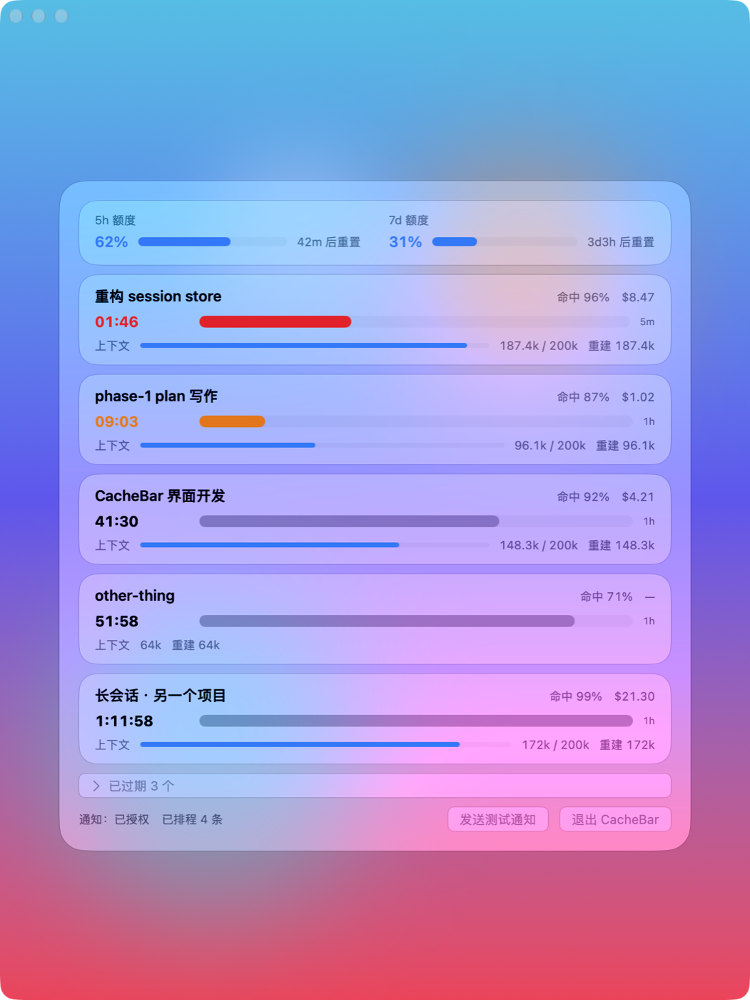

# CacheBar

常驻 macOS 菜单栏的 Claude Code 会话监视器，原生 Swift，Liquid Glass 面板。

Prompt 缓存过期后，下一次请求要把整个上下文重新写入缓存，上下文越大越贵。CacheBar 盯着每个会话的缓存还剩多久，在过期前发通知，让你来得及续上，或者决定放弃。



状态：一阶段可用，作者自用中。目前只支持 Claude Code，只发本机通知。没有预编译版本，需要从源码构建。

## 它显示什么

菜单栏标题是最紧急那个会话的 `命中率 · 缓存倒计时`。点开面板：

| 位置 | 内容 |
| --- | --- |
| 顶部 | 5 小时与 7 天额度的已用百分比、量条、重置倒计时（账号级，只显示一次） |
| 每个会话 | 缓存过期倒计时与剩余寿命条、本轮缓存命中率、上下文占用、本次会话花费、过期后重建要写入的 token 数 |
| 底部 | 已过期会话（默认折叠）、通知授权状态、已排程的通知数 |

倒计时在剩 10 分钟时变橙，剩 2 分钟时变红，这两个时刻各发一条通知。会话有新请求后，通知会按新的过期时间重排。

过期时刻的口径：会话最后一次触碰缓存的请求时间（读和写都算，因为命中读取也会刷新 TTL）加上该次写入的 TTL 档位（5 分钟或 1 小时）。subagent 的缓存独立计算，不计入主会话。

## 数据从哪来

CacheBar 只读本机文件，不读任何凭据，不发网络请求。

| 来源 | 覆盖 | 能拿到 |
| --- | --- | --- |
| statusline 快照 | Claude Code CLI 会话 | 全部指标，过期时刻直接用 Claude Code 自己算的值 |
| transcript（`~/.claude/projects/**/*.jsonl`） | 所有会话，包括桌面 App 里的 | 命中率、倒计时、上下文；没有花费、额度和会话名 |

两个来源都有时以 statusline 为准。额度只能从 statusline 拿，所以只开桌面 App、没有 CLI 会话在跑时，顶部额度停在上次的值。

transcript 兜底不需要任何配置。想要完整指标，按下面接入 statusline。

## 安装

需要 macOS 26 或更高版本、Swift 6.2 或更高版本（Xcode 26 或 Command Line Tools 均可），以及 `jq`（statusline 桥接脚本用）。

```bash
git clone https://github.com/FairladyZ625/CacheBar.git
cd CacheBar
scripts/setup-signing.sh    # 可选但建议，见下文“签名”
scripts/build-app.sh        # 生成 dist/CacheBar.app
open dist/CacheBar.app      # 菜单栏出现图标，Dock 不出现
```

首次启动会请求通知权限。如果被 Gatekeeper 拦下，在 Finder 里右键应用，选“打开”。

### 接入 statusline

Claude Code 每次刷新状态栏时，会把一份 JSON 从标准输入交给 statusline 命令。`scripts/statusline-bridge.sh` 把这份 JSON 存到 `~/Library/Application Support/CacheBar/sessions/<session_id>.json`，再原样输出，任何环节失败都静默放行，不影响状态栏本身。

已经有 statusline 脚本的话，在它读完标准输入之后加一行，路径换成你的克隆位置：

```bash
input=$(cat)
printf '%s' "$input" | /path/to/CacheBar/scripts/statusline-bridge.sh >/dev/null
```

还没有 statusline 的话，在 `~/.claude/settings.json` 里加一个最简单的，桥接脚本的输出交给 `jq` 取模型名显示：

```json
{
  "statusLine": {
    "type": "command",
    "command": "/path/to/CacheBar/scripts/statusline-bridge.sh | jq -r '.model.display_name'"
  }
}
```

字段说明见 [docs/statusline-schema.md](docs/statusline-schema.md)。

### 签名

没有 Apple 开发者证书也能用。区别在于通知授权能不能保留：

- 不做任何设置时，`build-app.sh` 用 ad-hoc 签名。每次重新构建，macOS 都把它当成一个新应用，通知授权会丢，需要重新去系统设置里打开。
- 运行一次 `scripts/setup-signing.sh`，它会在登录钥匙串里建一张名为 `CacheBar Local Signing` 的自签名证书，之后 `build-app.sh` 自动用它签名，重新构建不再丢授权。脚本不需要 sudo，不改系统信任设置，`--remove` 可撤销。

细节和取舍见 [docs/signing.md](docs/signing.md)。

## 开发

```bash
swift build
swift test
swift run CacheBarPreview   # 用假数据在普通窗口里渲染面板，方便调界面
```

代码分四个 target：`CacheBarCore`（数据模型、Claude Code 适配器、通知排程，纯逻辑）、`CacheBarUI`（面板与菜单栏标题）、`CacheBar`（应用入口）、`CacheBarPreview`（仅开发用，不进打包产物）。

新的 agent 通过实现 `AgentAdapter` 协议接入，产出统一的 `SessionSnapshot`，界面不用改。

## 路线

一阶段的范围和设计见 [docs/phase-1-plan.md](docs/phase-1-plan.md)。之后计划做：

- Codex、Antigravity、ZCode 等其他 coding agent 的适配器
- 按天、按项目、按模型的用量统计
- 手机推送（通过 Bark 或 ntfy 这类自带推送通道的 App）
- 可选的过期前自动压缩：上下文超过可调阈值且临近过期仍未动的会话，自动触发压缩

## 已知限制

- 只开桌面 App 时没有花费和额度数据。
- 通知对所有未过期会话都发，暂时不能按上下文大小过滤。
- 首次授予通知权限后，需要重启一次 CacheBar 才开始排程通知。

## License

[MIT](LICENSE)
